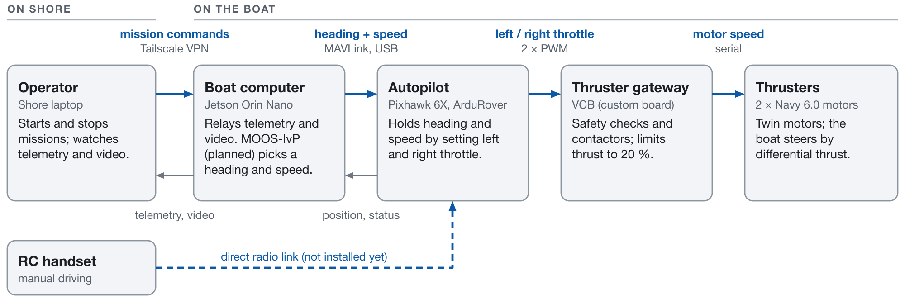
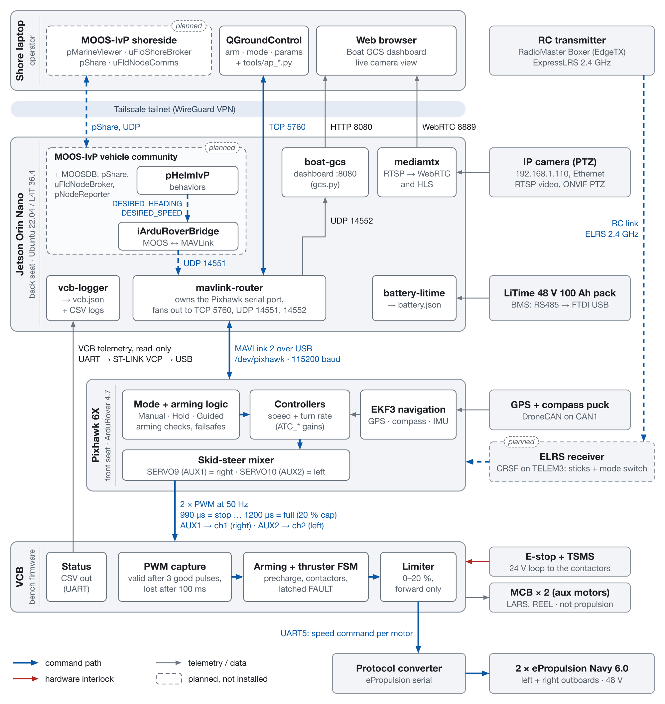
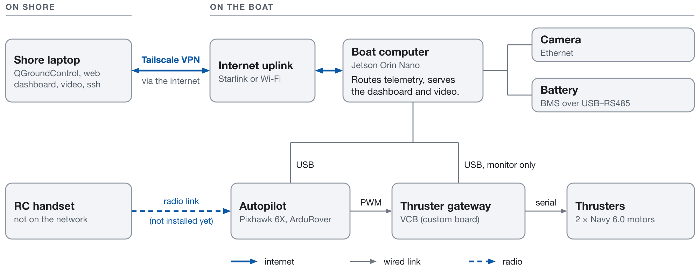
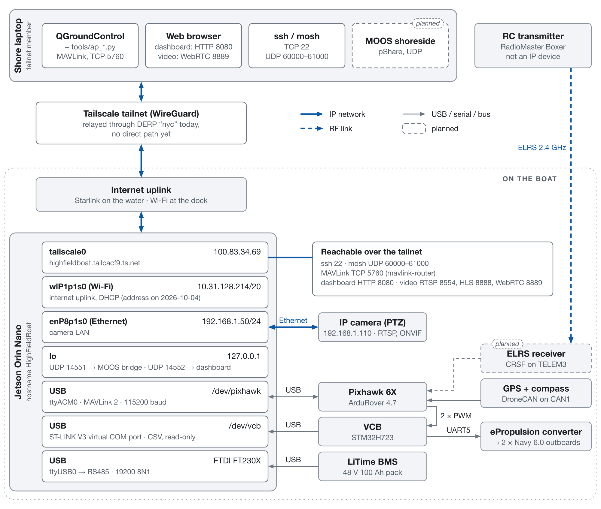
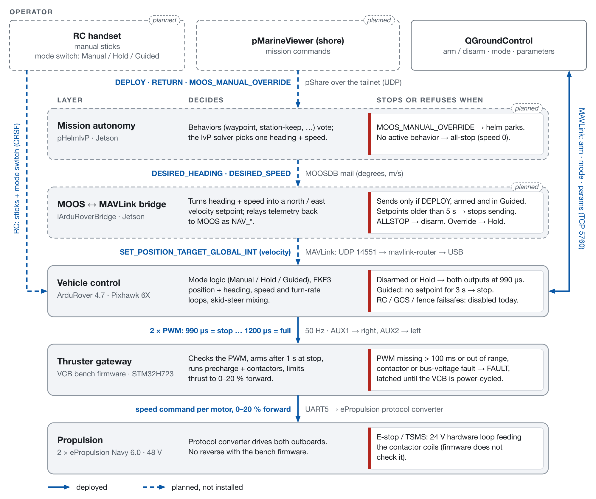

# Figures

Diagrams of the Project Remora software stack, as of 2026-10-05. Dashed boxes and dashed lines
mark things that are planned but not installed yet.

| Figure | Use it for |
|---|---|
| `fig0_system_components.png` | Every physical component on the boat, with power, data and command links |
| `fig1_system_overview.png` | A first look at the stack |
| `fig1_system_architecture.png` | Reference: every process on every computer, and what it talks to |
| `fig2_network_overview.png` | How the laptop reaches the boat, and what the Jetson is wired to |
| `fig2_network.png` | Reference: addresses, ports and protocols on every link |
| `fig3_control_layers.png` | Reference: what each control layer decides, and what makes it stop |
| `fig4_safety_cascade.png` | The four ways to safe the boat, softest to hardest, with what each does not cover |

All seven are drawn by [`make_figures.py`](make_figures.py). To change one, edit the text and
coordinates in that script and re-run it; don't edit the images.

```sh
python3 docs/figures/make_figures.py     # needs rsvg-convert (brew install librsvg)
```

## Components


Dashed boxes carry a tag. *planned*: the mesh radio for the UAV. *ordered*: the ELRS XR3 receiver.
*unverified*: the MCB boards and the tether power box were built for the 2025 white paper
(`docs/previous pdfs/`) but have not been checked on this boat, and the 400 V tether was never run
in the water. The UAV and ROV are the 2025 vehicles, each with its own Pixhawk and Raspberry Pi.

## System





## Network





## Control layers



## Safety cascade


Read left to right: each tier is there to catch the one before it failing. The red status in the
autopilot tier is the open item: all ArduRover failsafes are off until the RC receiver is installed.
The remote relay E-stop in tier 4 is an idea, not a chosen part.
